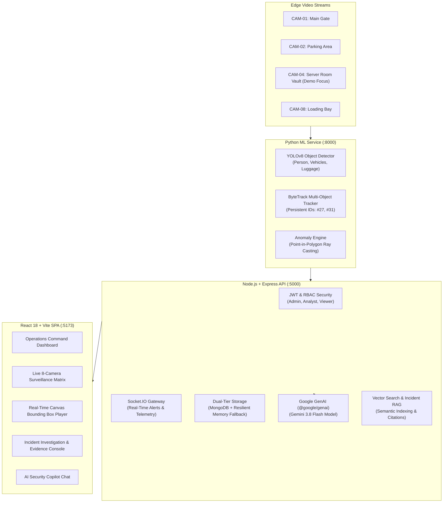

# VISIONGUARD 🛡️
### AI-Powered Real-Time Video Intelligence & Anomaly Detection Platform
> **Tagline**: *"See. Understand. Respond."*

🌐 **Live Demo Application**: [https://gauravguptanoida19-bit.github.io/VISIONGUARD/](https://gauravguptanoida19-bit.github.io/VISIONGUARD/)  
📂 **GitHub Repository**: [https://github.com/gauravguptanoida19-bit/VISIONGUARD](https://github.com/gauravguptanoida19-bit/VISIONGUARD)

[](https://gauravguptanoida19-bit.github.io/VISIONGUARD/)
[](https://www.typescriptlang.org/)
[](https://react.dev/)
[](https://nodejs.org/)
[](https://fastapi.tiangolo.com/)
[](https://ai.google.dev/)
[](LICENSE)

---

## ⚡ Executive Summary

**VisionGuard** is an enterprise-grade video intelligence and physical security surveillance SaaS platform. Built for high-stakes perimeter control, data centers, and corporate facilities, VisionGuard ingests live multi-camera video streams, executes sub-15ms object detection and ByteTrack trajectory tracking, detects security anomalies in real time, generates autonomous multimodal AI incident explanations with **Google Gemini 3.8 Flash**, and powers a conversational **AI Security Copilot** with Retrieval-Augmented Generation (RAG).

The platform is designed with **zero prerequisite friction**: it includes automated hackathon demo simulation, dual-tier resilient storage (MongoDB + In-Memory fallback), and dual-tier computer vision inference (YOLOv8 + High-Fidelity kinematic simulation), allowing full local evaluation without requiring paid API keys or dedicated GPU hardware.

---

## 🏗️ System Architecture



---

## 🚀 Quick Start (Local Development)

### 1. Clone & Install
```bash
git clone https://github.com/your-org/visionguard.git
cd visionguard

# Install monorepo dependencies
npm install
npm --prefix shared install
npm --prefix shared run build
npm --prefix backend install
npm --prefix frontend install
```

### 2. Configure Environment (.env)
A pre-configured `.env` is provided with defaults:
```ini
NODE_ENV=development
PORT=5000
FRONTEND_URL=http://localhost:5173
JWT_SECRET=visionguard_production_secret_key_2026_secure
DEMO_MODE=true

# Optional: Add your Google Gemini API Key for live LLM reasoning
GEMINI_API_KEY=
GEMINI_MODEL=gemini-3.8-flash
```

### 3. Start Backend & Frontend
In PowerShell or Terminal:
```bash
# Terminal 1: Start Backend API & Real-time Socket Server
npm run dev:backend

# Terminal 2: Start React Frontend
npm run dev:frontend
```
Open **`http://localhost:5173`** in your browser.

---

## 🏆 Hackathon 3-Minute Live Demo Walkthrough

VisionGuard is engineered to deliver a flawless, high-impact demonstration in under 3 minutes:

1. **Launch Dashboard**: Open `http://localhost:5173`. Click **"Launch Dashboard"**.
2. **1-Click Operator Login**: On the login screen, click **"Analyst"** (`analyst@visionguard.ai`) to sign in instantly with full analytical permissions.
3. **Review Operations Center**:
   - Observe live KPI cards (Active Cameras, People Detected, Active Incidents, High Risk Alerts).
   - View the **Threat Severity Breakdown** and **7-Day Anomaly Velocity** charts.
4. **Open CAM-04 (Server Room Vault)**:
   - Click **"Monitor CAM-04"** from the top banner or navigate to **Live Cameras $\rightarrow$ CAM-04**.
   - Notice the live video feed with dynamic bounding box overlays, tracking IDs (**Person #27**, **Person #31**), confidence percentages, and the red dashed **Restricted Zone boundary**.
5. **Simulate Zone Breach**:
   - Click the red **"Simulate Zone Breach"** button on the top right.
   - Watch **Person #27** cross into the restricted perimeter.
   - An instantaneous **HIGH SEVERITY ALERT** banner drops down with an audible chime: *"Restricted zone entry detected by Person #27 in Server Room Vault"*.
6. **Investigate Incident #VG-1842**:
   - Click **"Investigate"** on the alert banner to open the dedicated Incident Console.
   - Review the **3-Frame Keyframe Sequence** capturing the breach timeline.
   - Click **"AI Analyze"**: watch **Gemini 3.8 Flash** generate a structured forensic breakdown:
     * *Executive Summary*
     * *What Happened & Why Flagged*
     * *Timestamped Incident Timeline*
     * *Probable Hypothesis*
     * *Recommended SOP Next Steps*
7. **Consult the AI Security Copilot**:
   - Navigate to **AI Copilot** in the sidebar.
   - Click the suggestion chip: *"Why was incident VG-1842 flagged?"* or *"Show me similar incidents"*.
   - Watch the Copilot synthesize an answer with **Grounded RAG Citation Cards** linking directly back to past records.
8. **Export Audit Report**:
   - Navigate to **Reports** and click **"Print Report"** to view the clean, audit-ready physical security dossier.

---

## 🔐 Role-Based Access Control (RBAC)

VisionGuard provides 3 pre-seeded role accounts (password: `password123`):

| Role | Email | Capabilities |
| :--- | :--- | :--- |
| **Administrator** | `admin@visionguard.ai` | Full platform control, camera provisioning, polygon zone editor, operator directory |
| **Security Analyst** | `analyst@visionguard.ai` | Triage incidents, trigger AI forensic reasoning, add investigation notes, search records |
| **Viewer** | `viewer@visionguard.ai` | Read-only live camera monitoring, telemetry inspection, report review |

---

## 🧠 Technical Highlights & Interview Defense

- **Why YOLOv8?**: Single-stage, anchor-free detection enabling sub-15ms frame inference across concurrent RTSP feeds without the latency overhead of RPN networks.
- **Why ByteTrack?**: Solves track ID fragmentation by recovering low-confidence detections through two-stage IoU association.
- **Point-in-Polygon Engine**: Evaluates ground foot contact coordinates $(x_{foot}, y_{foot})$ against multi-vertex zone boundaries using Jordan curve ray casting.
- **Resilient Dual-Tier Storage**: Automatically falls back to an in-memory repository if local MongoDB is absent, ensuring zero demo failures.
- **Comprehensive Interview Q&A**: Refer to [docs/INTERVIEW_DEFENSE.md](docs/INTERVIEW_DEFENSE.md) for detailed technical defense questions and architectural justifications.

---

## 🐳 Docker Deployment

To launch the complete production stack (Frontend, Backend, Python ML Service, MongoDB, Redis):
```bash
docker compose up --build
```
- Frontend: `http://localhost:5173`
- Backend API: `http://localhost:5000`
- ML Service: `http://localhost:8000`

---

## 📄 License
Released under the [MIT License](LICENSE). Copyright © 2026 VisionGuard AI.
