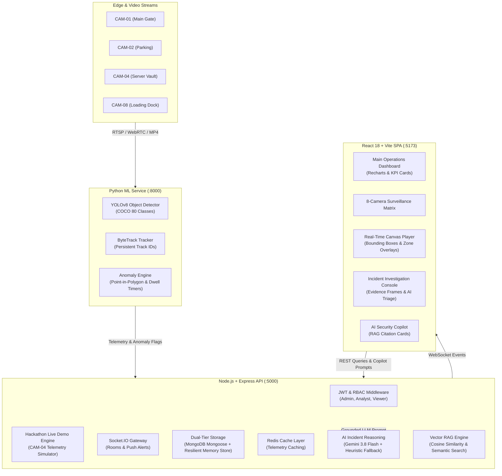

# VisionGuard Architecture & Technical Specification

> **Platform Tagline**: *"See. Understand. Respond."*  
> **Classification**: Production-Grade AI Video Intelligence & Anomaly Detection Platform

---

## 1. High-Level System Architecture

VisionGuard decouples stream ingestion, neural inference, stateful tracking, anomaly heuristics, and generative LLM reasoning into an event-driven microservices topology:

---

## 2. Real-Time Data Flow

1. **Ingestion**: Raw camera feeds are decoded at configurable target inference FPS (e.g. 5–30 FPS).
2. **Object Detection**: YOLOv8 extracts normalized bounding boxes $[x_1, y_1, x_2, y_2]$, class labels (`person`, `car`, `truck`, `backpack`, `suitcase`), and confidence scores.
3. **Multi-Object Tracking (ByteTrack)**:
   - High-confidence detections ($\ge 0.6$) are matched against active Kalman track trajectories via Intersection over Union (IoU).
   - Low-confidence detections are subsequently matched against remaining tracks to prevent track ID fragmentation during partial occlusions.
4. **Spatial Anomaly Rule Evaluation**:
   - **Restricted Zone**: Point-in-polygon ray casting tests whether the subject's foot coordinates fall inside a defined boundary during restricted hours.
   - **Loitering**: Dwell time accumulator triggers when stationary duration $> 30$ seconds.
   - **Abandoned Object**: Detected luggage without a correlated person entity within $10\text{m}$ for $> 45$ seconds triggers alert.
5. **Real-time Alert Dispatch**:
   - Backend persists the incident and evidence frames.
   - Socket.IO broadcasts `incident:alert` and `notification:new` to all connected operator consoles with audible synthesized frequency ping.
6. **AI Forensic Synthesis (Gemini 3.8 Flash)**:
   - When an operator investigates, structured telemetry (timeline, track history, coordinates) is sent to Gemini to generate an incident summary, why it was flagged, and actionable SOP next steps.
7. **Conversational Copilot (RAG)**:
   - Past incidents are vectorized and indexed. Operators query in natural language (*"Show suspicious activity from today"*), retrieving top-$k$ grounded incident sources with direct clickable links.

---

## 3. Database Schema

The platform implements schemas for:
- `User`: ID, name, email, passwordHash, role (`admin`, `analyst`, `viewer`), avatar.
- `Camera`: ID, name, location, streamUrl, status, fps, resolution, zones, activeObjectsCount.
- `Zone`: ID, cameraId, name, type (`restricted`, `loitering`), polygon coordinates, activeHours, severity.
- `Incident`: ID, incidentNumber (`VG-1842`), cameraId, type, severity, status, timestamp, duration, detectedObjects, evidenceFrames, aiAnalysis, analystNotes.
- `Notification`: ID, incidentId, cameraId, title, message, severity, timestamp, read status.
- `AuditLog`: Action, operator ID, target, details, timestamp.
